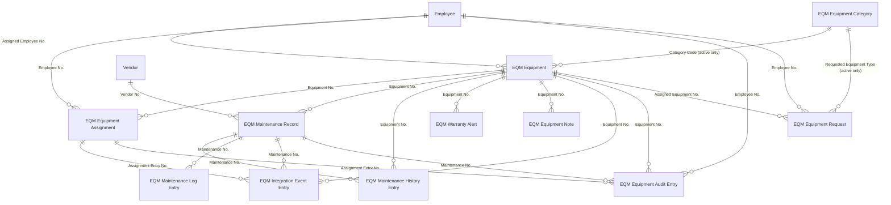

# Architecture overview

> Applies to Equipment Management 29.0.0.0 (not released). Facts are taken from the repository on branch feature/FR-060-developer-documentation; nothing is verified in a Business Central sandbox.

Equipment Management is one AL extension (`app/`) with a separate test extension (`test/`). It extends Business Central only through events and extension objects. This page describes the platform settings, the design principles, the functional modules, the data model, the main flows and the points where the app touches standard Business Central.

**In this article**
- [Platform and manifest](#platform-and-manifest)
- [Design principles](#design-principles)
- [Functional modules](#functional-modules)
- [Data model](#data-model)
- [Key flows](#key-flows)
- [Cross-cutting concerns](#cross-cutting-concerns)
- [Install and upgrade](#install-and-upgrade)
- [Extension points into standard Business Central](#extension-points-into-standard-business-central)
- [Related](#related)

## Platform and manifest

Source: [`app/app.json`](../../app/app.json). `app.json` is the source of truth; if this table disagrees with it, `app.json` wins.

| Property | Value |
|---|---|
| id | `e6c30407-ec71-4f48-a790-70da80abc992` |
| name / publisher | `Equipment Management` / `Miguel Carvalho` |
| version | `29.0.0.0` (Major.Minor from `app.json`; Build and Revision are stamped by CI, see [CI/CD](../setup/ci-cd.md)) |
| application / platform | `29.0.0.0` / `1.0.0.0` |
| runtime | `18.0` |
| target | `Cloud` |
| idRanges | 50100 to 50149 (demo range, see [AppSource readiness](appsource-readiness.md)) |
| features | `NoImplicitWith`, `TranslationFile` |
| dependencies | none (see [Dependencies](dependencies.md)) |
| internalsVisibleTo | the test app `Equipment Management Tests` (`eef4c303-e1d4-40b5-bc85-dd8bec4e0748`) |
| namespace of all objects | `MiguelCarvalho.EquipmentManagement` (tests: `MiguelCarvalho.EquipmentManagement.Tests`) |
| `privacyStatement`, `EULA`, `help`, `url`, `logo` | empty (open AppSource items) |

The `description` in `app.json` mentions assigning equipment to resources. The app does not support resources. This is recorded in [`docs/TODO.md`](../TODO.md) ("AppSource FAILs").

## Design principles

The rules are in [`CLAUDE.md`](../../CLAUDE.md) and the `al-patterns` skill (`.claude/skills/al-patterns/SKILL.md`; the `.claude/` folder is not tracked in git). In short:

- **Extend, never modify.** Standard objects are changed only through event subscribers and extension objects. Standard code is never copied.
- **One codeunit per responsibility.** Business logic lives in `... Mgt.` codeunits. Subscriber codeunits (`... Subscr.`, `... Subscribers`) only delegate: no business logic in the subscriber body, no `Commit`, no UI without a `GuiAllowed()` check, and table-trigger subscribers exit on `Rec.IsTemporary()`.
- **`Access = Internal` by default.** The public surface is deliberate and listed in [extension structure](extension-structure.md#public-surface).
- **Affix `EQM`** on every object and on every member added to a standard object. `app/AppSourceCop.json` makes it mandatory.
- **Texts and errors.** User-facing text is in labels with a suffix (`Err`, `Msg`, `Qst`, `Lbl`, `Tok`, `Txt`) and a `Comment` for every placeholder. `Tok` labels are `Locked = true`. Errors say what is wrong, on which record and what to do.
- **Published events are public API.** A new event is `[IntegrationEvent(false, false)]` and its signature never changes after release. See [events](../api/events.md).
- **Obsolete, never delete.** After the first AppSource release, published objects, fields and public procedures are never removed, renamed or retyped.

## Functional modules

One row per folder under `app/src`. The key objects are `ID`s with their type; the full list is in the [object inventory](extension-structure.md#object-inventory-app).

| Module | Responsibility | Key objects | Feature docs |
|---|---|---|---|
| `API` | REST API v1.0 pages for equipment, categories, assignments and integration events | pages 50123 to 50126 | [FR-026](../features/FR-026-equipment-api.md), [FR-027](../features/FR-027-equipment-categories-api.md), [FR-028](../features/FR-028-assignment-history-api.md) |
| `Assignment` | Assignment history; opens and closes assignment entries when equipment is saved | table 50103, codeunit 50106, enum 50101, pages 50104 and 50105 | [FR-004](../features/FR-004-equipment-assignment.md), [FR-005](../features/FR-005-equipment-unassignment.md), [FR-006](../features/FR-006-assignment-history-tracking.md) |
| `Attachments` | Documents on equipment through the standard Document Attachment framework | table extension 50100, page extension 50101, codeunits 50118 and 50137, enum 50108, page 50139 | [FR-024](../features/FR-024-document-attachments.md) |
| `AuditTrail` | Read-only lifecycle timeline per equipment | table 50112, codeunits 50135 and 50136, enum 50111, page 50136 | [FR-035](../features/FR-035-equipment-audit-trail.md) |
| `BusinessEvents` | The five partner events and the subscriber that raises the two "created" events | codeunits 50119 and 50120 | [FR-029](../features/FR-029-business-events.md) |
| `ChangeLog` | Registers equipment fields in the standard Change Log setup | codeunit 50133 | [FR-034](../features/FR-034-change-log-support.md) |
| `Dashboard` | KPI tiles, charts, Role Center and profile | table 50104, codeunit 50107, pages 50106 to 50110, 50118 and 50119, queries 50100 to 50103, profile `EQM EQUIPMENT MANAGER` | [FR-009](../features/FR-009-dashboard-kpis.md), [FR-021](../features/FR-021-maintenance-dashboard.md), [FR-022](../features/FR-022-warranty-dashboard.md), [FR-038](../features/FR-038-enhanced-role-center.md) |
| `DemoData` | Sample data for a new company | table 50149, codeunit 50149 | [FR-066](../features/FR-066-demo-data.md) |
| `Employee` | Employee Card extension, assigned-equipment FactBox, employee delete guard | page extension 50100, page 50112, codeunit 50103 | [FR-001](../features/FR-001-equipment-registration.md), [FR-004](../features/FR-004-equipment-assignment.md), [FR-037](../features/FR-037-factboxes.md) |
| `Equipment` | Equipment and category master data, status rules, UI | tables 50100 and 50101, enums 50100 and 50104, codeunit 50117, pages 50100 to 50102, 50111, 50122, 50137 and 50138 | [FR-001](../features/FR-001-equipment-registration.md), [FR-002](../features/FR-002-equipment-categories.md), [FR-003](../features/FR-003-equipment-status-management.md), [FR-008](../features/FR-008-equipment-card.md), [FR-014](../features/FR-014-warranty-information.md), [FR-023](../features/FR-023-equipment-images.md) |
| `ErrorLog` | Error log for unattended processes; runner that wraps the job bodies | table 50115, codeunits 50142 and 50143, enum 50113, page 50141 | [FR-051](../features/FR-051-error-logging.md) |
| `Features` | Per-company feature switches | table 50114, codeunit 50138, enum 50112, page 50140 | [FR-042](../features/FR-042-feature-management.md) |
| `Install` | Install and upgrade code, upgrade steps and tags | codeunits 50104, 50134 and 50139 | [FR-044](../features/FR-044-data-upgrade-support.md) |
| `Integration` | Integration event outbox | enum 50109, table 50110, codeunits 50121 and 50122, page 50132 | [FR-030](../features/FR-030-event-subscribers.md) |
| `Maintenance` | Maintenance records, posting, history, log | tables 50105, 50106 and 50108, codeunits 50108, 50109 and 50116, enums 50102, 50103 and 50107, pages 50113 to 50117 and 50121 | [FR-010](../features/FR-010-maintenance-registration.md), [FR-011](../features/FR-011-maintenance-history.md), [FR-012](../features/FR-012-equipment-maintenance-status.md), [FR-019](../features/FR-019-planned-maintenance.md) |
| `Monitoring` | Job queue entries for the daily jobs and the job codeunits | codeunits 50114, 50115 and 50145 | [FR-018](../features/FR-018-automated-background-processing.md), [FR-020](../features/FR-020-overdue-maintenance-monitoring.md), [FR-054](../features/FR-054-background-processing-optimization.md) |
| `Notes` | Dated, user-stamped notes on equipment | table 50109, pages 50130 and 50131 | [FR-025](../features/FR-025-equipment-notes.md) |
| `Notifications` | Notifications for warranty, overdue maintenance and returned equipment | codeunits 50112 and 50113 | [FR-017](../features/FR-017-equipment-notifications.md) |
| `Permissions` | Five permission sets and one permission set extension | permission sets 50100 to 50102, 50104 and 50105, extension 50103 | [FR-036](../features/FR-036-permission-sets.md), [FR-057](../features/FR-057-permission-review.md) |
| `PowerAutomate` | External business events and their subscriber | codeunits 50130 and 50131, enum extension 50100 | [FR-031](../features/FR-031-power-automate-support.md) |
| `Reports` | Four reports with Excel layouts, and the cost buffer table | reports 50100 to 50103, table 50113 | [FR-039](../features/FR-039-equipment-register-report.md), [FR-040](../features/FR-040-asset-utilization-report.md), [FR-041](../features/FR-041-maintenance-cost-analysis.md), [FR-052](../features/FR-052-usage-analytics.md) |
| `Request` | Equipment requests and approval | table 50111, codeunit 50132, enum 50110, pages 50133 to 50135 | [FR-032](../features/FR-032-equipment-request-process.md), [FR-033](../features/FR-033-approval-workflow.md) |
| `Setup` | Equipment Setup table, page and default data | table 50102, page 50103, codeunit 50105 | [FR-043](../features/FR-043-application-setup.md) |
| `Telemetry` | Usage signals to Application Insights | codeunits 50140 and 50141 | [FR-050](../features/FR-050-application-telemetry.md) |
| `UsageAnalytics` | Usage analytics data for the report | table 50116, codeunit 50144, query 50105 | [FR-052](../features/FR-052-usage-analytics.md) |
| `Warranty` | Warranty alerts and the daily alert job | table 50107, codeunits 50110 and 50111, enums 50105 and 50106, page 50120, query 50104 | [FR-015](../features/FR-015-warranty-monitoring.md), [FR-016](../features/FR-016-warranty-alerts.md), [FR-022](../features/FR-022-warranty-dashboard.md) |

## Data model

The diagram shows relations that exist as `TableRelation` properties in `app/src`. Several of them have `ValidateTableRelation = false`; they document the link but do not enforce it. The setup tables 50102 (EQM Equipment Setup), 50114 (EQM Feature Setup) and the buffer and demo tables have no relation to the core tables and are left out.

Table IDs: EQM Equipment 50100, EQM Equipment Category 50101, EQM Equipment Assignment 50103, EQM Maintenance Record 50105, EQM Maintenance History Entry 50106, EQM Warranty Alert 50107, EQM Maintenance Log Entry 50108, EQM Equipment Note 50109, EQM Integration Event Entry 50110, EQM Equipment Request 50111, EQM Equipment Audit Entry 50112.

## Key flows

Each call below was checked in the source on this branch.

**Assign equipment**
1. A caller (the Equipment Card action, the API action `assign`, `AssignEquipment` in codeunit 50132, or the demo data codeunit) calls `AssignEmployee` on table 50100 EQM Equipment. It validates `Status` and `Assigned Employee No.` and calls `Modify(true)`.
2. The `OnModify` trigger of the equipment calls `UpdateAssignmentOnSave` in codeunit 50106 EQM Assignment Mgt.
3. Codeunit 50106 closes leftover active entries, inserts the active entry in table 50103 (after its own hook `OnBeforeInsertAssignment`) and calls `OnEquipmentAssigned` of codeunit 50119 EQM Business Events.
4. The subscribers run in the same transaction: the audit trail (codeunit 50136), the integration event outbox (50121, only when "Integration Events Enabled" is on), telemetry (50141) and the Power Automate subscriber (50131), which raises the external event `equipmentAssigned`.
5. Return is the mirror: `UnassignEmployee`, then `CloseActiveAssignments` and `OnEquipmentReturned`.

**Register and post maintenance**
1. Inserting a record in table 50105 EQM Maintenance Record runs its `OnInsert`: number series, `CheckMaintenanceConsistency`, then `StartMaintenance` on the equipment (status In Maintenance; an assigned equipment is returned first) and `LogRegistered` in codeunit 50116 (table 50108).
2. The `OnAfterInsertEvent` subscriber in codeunit 50120 raises `OnMaintenanceCreated`.
3. Posting runs codeunit 50109 EQM Maintenance-Post (the Maintenance Records and Maintenance Record Card pages call `PostWithConfirmation` in codeunit 50108 first). It writes the history entry in table 50106 (after `OnBeforeInsertMaintenanceHistoryEntry`), logs the posting, calls `CompleteEquipmentMaintenance` (the equipment leaves In Maintenance when its last open record is posted) and raises `OnAfterPostMaintenanceRecord`.

**Approve an equipment request**
1. Table 50111 EQM Equipment Request is processed by codeunit 50132 EQM Request Approval Mgt.: `SendForApproval`, `Approve` or `Reject`, then `AssignEquipment`.
2. Every transition is saved by `SaveStatusChange`, which raises `OnAfterRequestStatusChanged`. `Approve` raises `OnBeforeCheckApproverAllowed` before the self-approval check.
3. `AssignEquipment` calls `AssignEmployee` on the equipment (the assignment flow above) and sets the request to Completed.

**Background jobs**
1. Three job codeunits exist: 50111 EQM Warranty Alert Job, 50114 EQM Maintenance Monitor Job and 50145 EQM Maintenance Calc. Job. Their `OnRun` only calls `RunJob` in codeunit 50143 EQM Monitoring Job Runner.
2. The runner runs the job body through `Run` on its own codeunit instance, so a failure can be caught. A failure is written to the error log (codeunit 50142) and raised again with the original text. When a write transaction is already open, the job runs as before, not isolated and not logged.
3. The warranty body generates alerts, calls `Commit`, then raises `OnWarrantyExpired` (see [events](../api/events.md)).
4. Codeunit 50115 EQM Monitoring Job Mgt. creates the job queue entries (on install, from Equipment Setup and from the setup page action).

## Cross-cutting concerns

| Concern | Where | Feature doc |
|---|---|---|
| Feature switches | enum 50112 EQM Feature (Equipment Images, Warranty Alerts, Approval Workflows, API Integration, Maintenance Planning, Notifications), table 50114, codeunit 50138 | [FR-042](../features/FR-042-feature-management.md) |
| Setup | table 50102 EQM Equipment Setup, page 50103 | [FR-043](../features/FR-043-application-setup.md) |
| Telemetry | codeunits 50140 and 50141; signals go to Application Insights | [FR-050](../features/FR-050-application-telemetry.md) |
| Error log | table 50115, codeunits 50142 and 50143 | [FR-051](../features/FR-051-error-logging.md) |
| Usage analytics | table 50116, codeunit 50144, query 50105, report 50103 | [FR-052](../features/FR-052-usage-analytics.md) |
| Change log registration | codeunit 50133, run on install and upgrade | [FR-034](../features/FR-034-change-log-support.md) |
| Translations | `app/Translations/*.xlf` (English source, pt-PT, es-ES) | [FR-055](../features/FR-055-multi-language-support.md) |
| Regional settings | dates, numbers and amounts follow the user's regional format | [FR-056](../features/FR-056-regional-settings.md) |
| Data classification | every table and field classified; no `ToBeClassified` | [FR-058](../features/FR-058-data-classification.md) |
| Performance | keys, `SetLoadFields`, one cache, retention policies, job queue | [FR-053](../features/FR-053-large-dataset-support.md), [FR-054](../features/FR-054-background-processing-optimization.md) |

## Install and upgrade

- **EQM Install** (codeunit 50104, `Subtype = Install`): `OnInstallAppPerCompany` first ensures the monitoring jobs (isolated), then creates default data, registers the change log setup and runs all upgrade steps.
- **EQM Upgrade** (codeunit 50134, `Subtype = Upgrade`): `OnUpgradePerCompany` registers the change log setup and runs all upgrade steps.
- **EQM Upgrade Mgt.** (codeunit 50139, internal): the steps, their tags and the `OnGetPerCompanyUpgradeTags` subscriber. Install and upgrade subtype codeunits cannot be run from tests (CodeCop AA0243), so the logic sits here and the tests call it ([FR-044](../features/FR-044-data-upgrade-support.md)).
- **Upgrade tags.** The source has two: `MC-EQM-FR044-DefaultWarrantyAlertDays-20261118` and `MC-EQM-FR054-RetentionPolicyTables-20261120`. **Never change a shipped tag**: it would run the step again in every company. The subscriber registers the first tag for new companies. The retention tag is deliberately not registered there, because new companies would then never register the tables.
- **New companies.** Default data and number series are created only in the install trigger. A company created later has no setup record. This is an open item in [`docs/TODO.md`](../TODO.md) ("New companies").
- Every release after 29.0.0.0 that changes data needs an upgrade step ([FR-044](../features/FR-044-data-upgrade-support.md), "How to add an upgrade step").

## Extension points into standard Business Central

Every extension object and every `[EventSubscriber]` in `app/src` whose publisher is a standard object. Subscribers to the app's own events are not listed here; see [events](../api/events.md).

| Standard object | Event or extension | Our object | Why |
|---|---|---|---|
| Table `Employee` | `OnBeforeDeleteEvent` | codeunit 50103 EQM Employee Subscribers | Blocks deleting an employee who has assigned equipment. |
| Page `My Notifications` | `OnInitializingNotificationWithDefaultState` | codeunit 50113 EQM Notification Subscribers | Registers the equipment notifications so users can switch them off. |
| Codeunit `Document Attachment Mgmt` | `OnAfterTableHasNumberFieldPrimaryKey` | codeunit 50118 EQM Doc. Attachment Subscr. | Tells the framework that equipment is identified by "No.". |
| Codeunit `Document Attachment Mgmt` | `OnAfterGetRefTable` | codeunit 50118 EQM Doc. Attachment Subscr. | Opens the equipment record an attachment belongs to. |
| Codeunit `Upgrade Tag` | `OnGetPerCompanyUpgradeTags` | codeunit 50139 EQM Upgrade Mgt. | Registers upgrade tags for new companies. |
| Table `Document Attachment` | tableextension 50100 `EQM Document Attachment` | field 50100 `EQM Attachment Category` | Category of an equipment document. |
| Page `Document Attachment Details` | pageextension 50101 `EQM Doc. Attachment Details` | field after `Name` | Shows the category for equipment attachments. |
| Page `Employee Card` | pageextension 50100 `EQM Employee Card` | FactBox, actions in Navigation and Processing | Shows assigned equipment and lets users return it. |
| Enum `EventCategory` | enumextension 50100 `EQM Event Category` | value 50100 `EQM Equipment Management` | Groups the external business events in Power Automate. |
| Permission set `D365 BASIC` | permissionsetextension 50103 `EQM D365 BASIC` | `tabledata "EQM Equipment" = r` (indirect) | Lets a user who may delete employees reach the guard error, not a permission error. |

The app also calls standard codeunits directly, for example `Upgrade Tag`, `Reten. Pol. Allowed Tables`, `No. Series` and `Confirm Management`. These are calls, not extension points.

## Related

- Feature docs listed in the tables above, and [`docs/features/`](../features/)
- [Extension structure](extension-structure.md), [Testing strategy](testing-strategy.md), [AppSource readiness](appsource-readiness.md), [Dependencies](dependencies.md)
- [Events and API](../api/README.md)
- [CLAUDE.md](../../CLAUDE.md)
- Microsoft Learn: [Events in AL](https://learn.microsoft.com/dynamics365/business-central/dev-itpro/developer/devenv-events-in-al), [Event types](https://learn.microsoft.com/dynamics365/business-central/dev-itpro/developer/devenv-event-types), [Extensibility overview](https://learn.microsoft.com/dynamics365/business-central/dev-itpro/developer/devenv-dev-overview)
