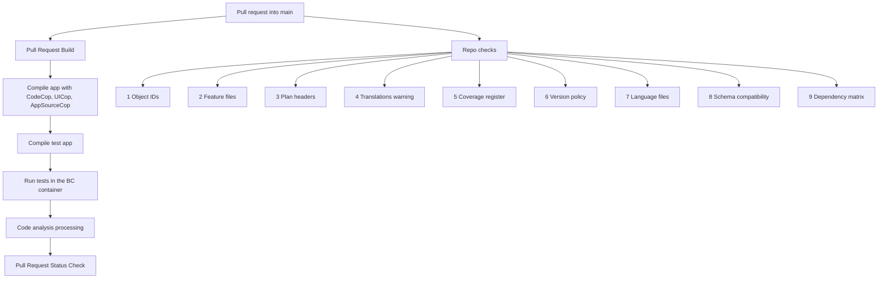

# CI/CD process

> Applies to Equipment Management 29.0.0.0 (not released). Facts are taken from the repository on branch feature/FR-060-developer-documentation; nothing is verified in a Business Central sandbox.

The repository is built, analysed and tested by AL-Go for GitHub (AppSource template, AL-Go v10.0) and by one extra workflow with repository rules. This page lists the workflows, the settings, the pull request pipeline, the versioning and how to read results.

**In this article**
- [Workflows](#workflows)
- [AL-Go settings](#al-go-settings)
- [Pull request pipeline](#pull-request-pipeline)
- [Versioning and releases](#versioning-and-releases)
- [Reading results](#reading-results)
- [Do not edit](#do-not-edit)
- [Related](#related)

## Workflows

All files are in `.github/workflows/`. The `name:` and `on:` values are copied from the files.

| Workflow file | Name | Trigger | Purpose |
|---|---|---|---|
| `CICD.yaml` | ` CI/CD` | Push to `main`, `release/*` and `feature/*` (skipped when only `**.md` or workflow files other than `CICD.yaml` changed); manual | Build, analyse and test; deploy, deliver and publish reference documentation only when configured (see below) |
| `PullRequestHandler.yaml` | `Pull Request Build` | Pull request into `main`; `merge_group` | Build, analyse and test the pull request; status check `Pull Request Status Check` |
| `RepoChecks.yaml` | `Repo checks` | Pull request into `main` | Runs `python3 .github/scripts/repo_checks.py` (this repository's own rules) |
| `_BuildALGoProject.yaml` | `_Build AL-Go project` | Reusable (`workflow_call`) | The build job used by CI/CD, pull request build and the forward checks |
| `Current.yaml` | ` Test Current` | Manual | Build and test against the current Business Central version |
| `NextMinor.yaml` | ` Test Next Minor` | Manual | Same against the next minor version |
| `NextMajor.yaml` | ` Test Next Major` | Manual | Same against the next major version |
| `CreateRelease.yaml` | ` Create release` | Manual | Promotes a build to a GitHub release |
| `IncrementVersionNumber.yaml` | ` Increment Version Number` | Manual | Opens a pull request that raises the version |
| `PublishToAppSource.yaml` | ` Publish To AppSource` | Manual | Delivers an app version to AppSource |
| `PublishToEnvironment.yaml` | ` Publish To Environment` | Manual | Deploys an app version to an environment |
| `DeployReferenceDocumentation.yaml` | ` Deploy Reference Documentation` | Manual | Publishes generated reference documentation (ALDoc); no use recorded in the repository |
| `UpdateGitHubGoSystemFiles.yaml` | ` Update AL-Go System Files` | Manual; `workflow_call` | Updates the AL-Go system files from the template |
| `CreateApp.yaml`, `CreateTestApp.yaml`, `CreatePerformanceTestApp.yaml`, `AddExistingAppOrTestApp.yaml`, `CreateOnlineDevelopmentEnvironment.yaml` | `Create a new app`, `Create a new test app`, `Create a new performance test app`, `Add existing app or test app`, ` Create Online Dev. Environment` | Manual | AL-Go helper workflows |
| `Troubleshooting.yaml` | `Troubleshooting` | Manual | Shows the names of available secrets |

Notes:
- `CICD.yaml` also has the jobs `Deploy`, `Deliver` and `DeployALDoc`. They run only when environments, delivery targets or the ALDoc artifact are configured. The repository files hold no such configuration; whether GitHub environments or secrets exist was not checked.
- The forward checks `NextMinor.yaml` and `NextMajor.yaml` are manual only. FR-048 describes them as inheriting the analyzer flags; they do not run on a schedule or on a pull request.

## AL-Go settings

`.github/AL-Go-Settings.json` (repository level):

| Key | Value | Effect |
|---|---|---|
| `type` | `AppSource App` | Selects the AppSource template behaviour, including AppSourceCop. |
| `templateUrl` | `https://github.com/microsoft/AL-Go-AppSource@main` | The template the system files come from. |

`.AL-Go/settings.json` (project level):

| Key | Value | Effect |
|---|---|---|
| `country` | `us` | Country of the build container. |
| `repoVersion` | `29.0` | Major.Minor in artifact names. Must equal Major.Minor of `app/app.json` (VER3). |
| `versioningStrategy` | `0` | Major and Minor from `app.json`; Build is the run number; Revision is the run attempt minus 1 (VER4). |
| `appSourceCopMandatoryAffixes` | `["EQM"]` | The affix AppSourceCop requires. |
| `appFolders` | `["app"]` | The app to build. |
| `testFolders` | `["test"]` | The test app to build and run. |
| `bcptTestFolders` | `[]` | No performance test apps. |
| `rulesetFile` | `.AL-Go/equipment.ruleset.json` | The CI ruleset. |
| `enableCodeCop` | `true` | CodeCop on the main app (FR-048). |
| `enableUICop` | `true` | UICop on the main app (FR-048). |
| `enableAppSourceCop` | `true` | AppSourceCop on the main app, explicit (FR-048). |
| `enableCodeAnalyzersOnTestApps` | `false` | The test app is not analysed in CI. With it `true`, PR #132 failed with AS0015 and AS0054 on the test app (FR-061). |

`.github/Test Current.settings.json`, `Test Next Minor.settings.json` and `Test Next Major.settings.json` set `artifact` to `////latest`, `////nextminor` and `////nextmajor` (the Business Central version the forward-check workflows build against), `cacheImageName` to empty and `versioningStrategy` to `15`. Check VER4 reads only `.AL-Go/settings.json`.

Ruleset `.AL-Go/equipment.ruleset.json` lowers three rules to Warning:

| Rule | Justification in the file |
|---|---|
| AS0051 | Manifest links (privacyStatement, EULA, help, logo, contextSensitiveHelpUrl) are not set yet. |
| AS0052 | Manifest url is not set yet. |
| AS0084 | Demo ID range 50100-50149; an AppSource range must be registered. |

The ruleset is temporary and **must be removed before a real AppSource submission**, together with the `rulesetFile` setting. `failOn` keeps its default (error), so only errors fail the build. Details and the exception register: [FR-048](../features/FR-048-automated-build-pipeline.md), [FR-061](../features/FR-061-code-quality-compliance.md).

## Pull request pipeline



- The two workflows run in parallel. `Pull Request Build` has the jobs `Initialization`, `Build`, `CodeAnalysisUpload` and `StatusCheck` (`Pull Request Status Check`). `PregateCheck` runs only for pull requests from forks.
- `Repo checks` is the single job `repo-checks` on `ubuntu-latest`. It checks out the full history and runs `repo_checks.py` with the base and head branch names.
- A push to `main` runs `CICD.yaml`, which builds and tests the same way. It is skipped for markdown-only changes, so a documentation-only pull request is covered by the pull request workflows only.
- TODO(verify): branch protection and required checks (`Pull Request Status Check`, `Repo checks`). `main` is described as protected in `CLAUDE.md`; the required checks were not read from GitHub settings (FR-048). If missing, the owner adds them in the GitHub settings.

## Versioning and releases

Summary of [FR-049](../features/FR-049-release-management.md):

- **Major.Minor** come from `version` in `app/app.json` (29.0). Agents do not edit `app.json`.
- **Build** is the GitHub run number and **Revision** is the run attempt minus 1. `app.json` keeps 0 for both.
- **Artifact names** follow `equipment-management-main-Apps-29.0.<run>.0` (the `repoVersion` is 29.0). FR-048 recorded `1.0.<run>.0` before FR-049 aligned them. The `.app` file carries the same 29.0.&lt;run&gt;.0 version.
- **Version checks** VER1 to VER7 run in Repo checks (check 6): four-part version, Build and Revision are 0, `repoVersion` matches, strategy 0, the test app depends on the app, the version does not go down, and a warning when Major or Minor is raised.
- **Schema checks** SCH00 to SCH14 run in Repo checks (check 8, FR-062) on pull requests only. They compare the `app/` AL source with `main`. An error fails the check; a warning is shown as an annotation. Accepted breaking changes are listed in `.github/schema/accepted-breaking-changes.json`. See [FR-062](../features/FR-062-breaking-change-validation.md).
- **Dependency checks** DEP1 to DEP6 run in Repo checks (check 9, FR-063). DEP6 warns on pull requests when a dependency, `application`, `platform` or `runtime` changes. See [Dependencies](../architecture/dependencies.md).
- **Release procedure** (not run for this repository): latest CI/CD run on `main` is green; check the upgrade steps; run **Create release** with `buildVersion` `latest`, tag `<Major>.<Minor>.<Build>`, `releaseType` `Release` and `updateVersionNumber` `+0.1`; merge the version-bump pull request; upload the `.app` to Partner Center manually (publishing is not automated).
- **No release exists yet.** `CreateRelease.yaml` and `IncrementVersionNumber.yaml` were never run.

## Reading results

```text
gh pr checks <pr>
gh run view <run-id> --log | grep -E "tests,|passed"
```

- AL-Go prints `<app>, N tests, N passed, N failed, N skipped` per test app.
- Build artifacts per run: `Apps`, `TestApps`, `TestResults`, `BuildOutput` (named like `equipment-management-main-Apps-29.0.<run>.0`), plus `Dependencies` and the container event log. Code analysis logs go to an `ErrorLogs` artifact when alerts are tracked.
- Example for the latest `main` run read on 2026-11-22: CI/CD run 44925652127, 569 tests, 569 passed, 0 failed (commit `e292f84`). The previous `main` run (44920033270) failed on one test; see [testing strategy](../architecture/testing-strategy.md#how-tests-run).
- Each result describes the commit of that run only. Quote the run or PR number when you claim a result.

## Do not edit

- The AL-Go system workflows (`.github/workflows/*.yaml`) are overwritten by `UpdateGitHubGoSystemFiles`. Do not edit them.
- Changes to AL-Go settings, the ruleset, the analyzers or `AppSourceCop.json` are user decisions, not contributor changes.
- `.github/RELEASENOTES.copy.md` is a copy of the AL-Go template release notes, not release notes of this app (see [release notes](../release-notes/README.md)).

## Related

- Feature docs: [FR-048](../features/FR-048-automated-build-pipeline.md), [FR-049](../features/FR-049-release-management.md), [FR-061](../features/FR-061-code-quality-compliance.md), [FR-062](../features/FR-062-breaking-change-validation.md), [FR-063](../features/FR-063-dependency-management.md)
- [Setup](README.md), [Testing strategy](../architecture/testing-strategy.md), [AppSource readiness](../architecture/appsource-readiness.md)
- Microsoft Learn: [AL-Go for GitHub overview](https://learn.microsoft.com/dynamics365/business-central/dev-itpro/al-go/algo-overview), [Version numbers](https://learn.microsoft.com/dynamics365/business-central/dev-itpro/administration/version-numbers)
